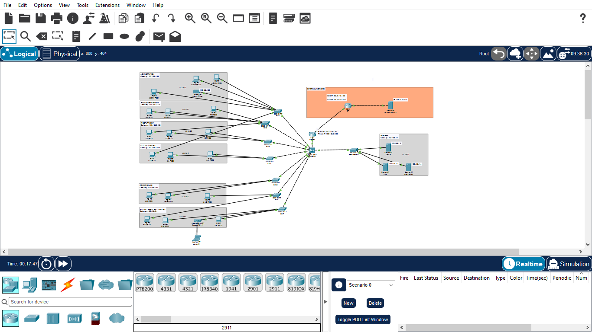
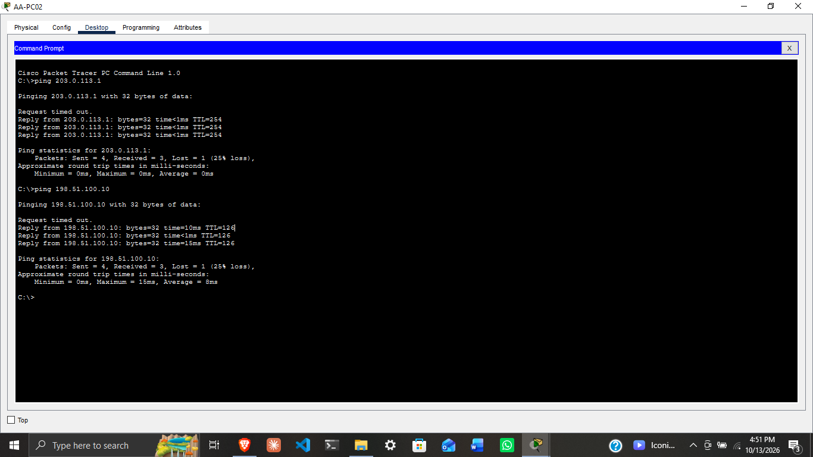
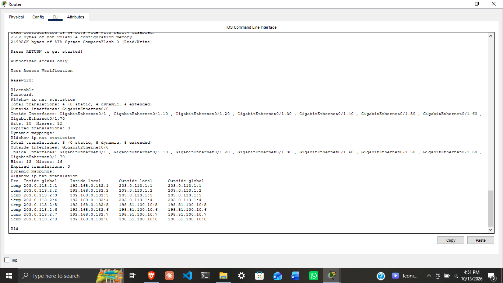

# Senior High School Network Design

## Overview

This project involves the design and simulation of a computer network for a senior high school using Cisco Packet Tracer. The network is designed to support communication between departments, provide access to shared services, and enable connectivity to an external network.

The design focuses on network segmentation, efficient IP address allocation, centralized services, and connectivity between the school's internal network and an external network.

## Project Objectives

- Design a structured network for a senior high school.
- Segment departmental devices using VLANs.
- Apply Variable Length Subnet Masking (VLSM) for IP address allocation.
- Configure inter-VLAN routing.
- Provide network services such as DHCP and DNS.
- Implement and test NAT/PAT for external network connectivity.

## Technologies and Concepts

- Cisco Packet Tracer
- VLANs and trunking
- IPv4 addressing and subnetting
- Variable Length Subnet Masking (VLSM)
- Inter-VLAN routing
- DHCP and DNS
- Network Address Translation (NAT/PAT)

## Network Architecture

The network is designed to support the school's departments through logical segmentation, structured IP addressing, and centralized network services.

The topology below illustrates the network layout, including departmental devices, switching infrastructure, routing, and the connection to the simulated external network.

## Verification

Connectivity was tested from an internal departmental PC to the external server at `198.51.100.10`. A successful ICMP ping demonstrated end-to-end connectivity within the simulated network.

NAT/PAT operation was verified using the router's NAT translation table and statistics.

### External Server Connectivity

### NAT/PAT Translation Verification

## Project Files

- `School_network.pkt` — Cisco Packet Tracer simulation file.
- `screenshots/` — Screenshots showing the network architecture and connectivity verification.

## Scope

This is an academic network design and simulation project. The external network and server are simulated in Cisco Packet Tracer and do not represent a connection to a live ISP or the public internet.
